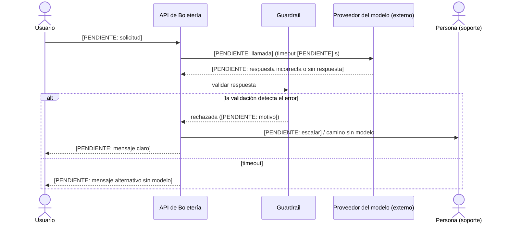

# ADR-002: <la decisión, en una línea>

Estado: propuesto

## Contexto y fuerzas

**Punto del sistema:** [PENDIENTE]

**Patrón(es):** [PENDIENTE]

**Fuerzas:**

- Gravedad de un error: [PENDIENTE: qué pasa en el caso si el modelo responde mal]
- Costo por llamada: [PENDIENTE: llamadas esperadas vs. 120.000 compradores]
- Tiempo que puede esperar el usuario: [PENDIENTE: comparar con la pasarela de 2-10 s, la fila < 3 s p95 o la puerta < 1 s]
- Datos que recibe el modelo: [PENDIENTE: datos personales, Ley 1581 de 2012 (RNF-12)]
- **Sin modelo de lenguaje:** [PENDIENTE: ¿se resuelve con un `if`, una búsqueda o una página de preguntas frecuentes? Es la primera alternativa y se descarta con argumentos, o es la decisión]

## Decisión

<!--
Paso 3: diagrama de secuencia en Mermaid de la FALLA, no del camino normal.
Debe mostrar: (1) el momento del error, (2) qué lo detecta (validación, límite,
timeout) y (3) cómo termina (una persona decide, camino sin modelo, o mensaje
claro al usuario). Ajustar los participantes y mensajes al caso.
-->

[PENDIENTE: la decisión en prosa]

**Vista de contenedores (paso 4):** [PENDIENTE: agregar el proveedor del modelo en `docs/contenedores.dsl` como sistema externo, con protocolo, síncrono o asíncrono y tiempo máximo de espera]

## Alternativas descartadas

<!-- Cada una con su razón, usando datos del caso. -->

1. **Sin modelo de lenguaje:** [PENDIENTE]
2. [PENDIENTE: otro patrón de los cinco, o otra forma de resolverlo]

## Modo de falla y control

<!--
Un modelo puede equivocarse sin lanzar ninguna excepción. Aquí va qué mecanismo
detecta el error ANTES de que llegue al usuario.
-->

- **Modo de falla:** [PENDIENTE: respuesta incorrecta sin error, monto fuera de rango, dato de otro usuario, sin respuesta]
- **Qué lo detecta:** [PENDIENTE: validación, límite o timeout, con el valor concreto]
- **Cómo termina:** [PENDIENTE: persona decide, camino alternativo sin modelo o mensaje claro]

## Cómo se mide que funciona

<!--
Un conjunto de casos de prueba y un porcentaje mínimo de aciertos. Con número,
no "se verificará que funcione".
-->

- **Conjunto de casos de prueba:** [PENDIENTE: cantidad y de dónde salen]
- **Porcentaje mínimo de aciertos:** [PENDIENTE: número y por qué ese]
- **Cómo se ejecuta:** [PENDIENTE: comando o script; el adaptador simulado del modelo basta]

## Consecuencias

<!-- Ventaja, costo y qué nuevo puede fallar, con datos del caso. -->

- **Ventaja:** [PENDIENTE]
- **Costo:** [PENDIENTE: dinero por llamada, latencia añadida, complejidad]
- **Nueva falla posible:** [PENDIENTE]
- **Señal que nos haría cambiar de opinión:** [PENDIENTE]
