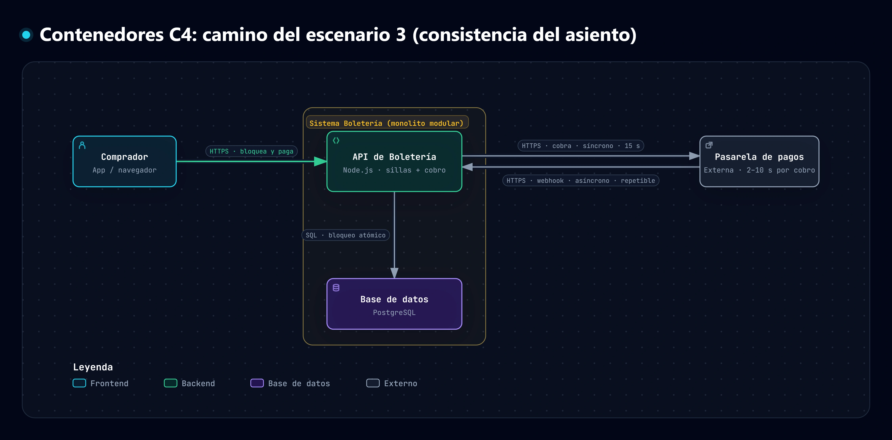
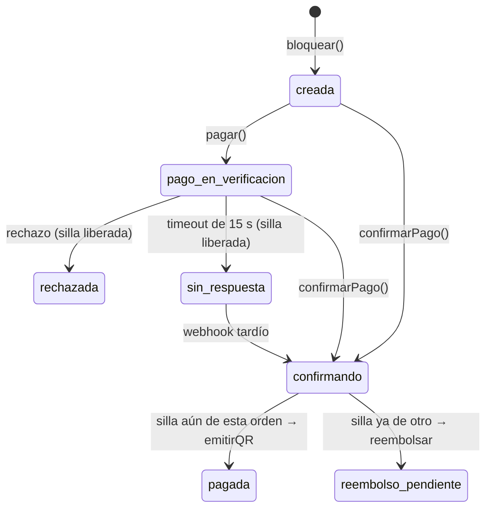

# ADR-003: Bloqueo atómico con vencimiento e idempotencia con `orden_id` para que cada silla se venda una sola vez

Estado: aceptado

## Contexto

**Escenario elegido:** escenario 3 del ADR-000, *consistencia del asiento (cada silla, una sola vez)*, que corresponde a RNF-05.

**Por qué este y no los otros:** es una de las tres demandas del caso: *"El asiento H-14 no puede venderse dos veces, ni quedar bloqueado para siempre por un carrito abandonado"*. Además es el único error irreversible, porque una doble venta *"no se puede corregir el día del evento"* (ADR-000). Su falla vive en el código del monolito, así que se reproduce con una prueba automatizada en segundos. Los otros escenarios no permiten eso:

- La fila virtual (< 3 s en el p95 con 120.000 concurrentes, P4) depende de la infraestructura de borde.
- La puerta (< 1 s sin red, P5) depende del lector Android, que todavía no existe en el código.
- Los escenarios 4 y 5 dependen del worker y del modelo de lenguaje, que se construyen después.

**Medida del escenario (número, origen y ventana):**

- **Número:** exactamente **1 venta y 1 cobro** sobre H-14, con 199 intentos rechazados, en **100 de 100 repeticiones**.
- **Origen del número:**
  - 0 dobles ventas: el caso y RNF-05.
  - 1 cobro: idempotencia con `orden_id` (`flujo-checkout.md`, paso 2).
  - 200 intentos **(S)**: 25 veces el promedio de 8 compradores por silla (120.000 / 15.000).
  - 100 repeticiones **(S)**: una sola corrida puede pasar por azar.
- **Ventana de tiempo:** cada repetición ocurre dentro del bloqueo de 10 minutos **(S)**. En la prueba, 1 s del caso equivale a 2 ms, así que el bloqueo dura 1.200 ms. Cada sentencia de BD cuesta 2 ms.

**Camino en la vista de contenedores:** el comprador bloquea y paga en la API de Boletería, que escribe en PostgreSQL (`sillas`, `ordenes`, `outbox`) y cobra a la pasarela de forma síncrona, con timeout de 15 s. La pasarela devuelve la confirmación por un webhook **repetible**: esa flecha de vuelta es la que convierte una confirmación en dos.



**Falla reproducible:** la provoca el adaptador simulado `src/pagos/pasarela-simulada.js`, con la bandera `modoPasarela` de `crearSistema()`. Tiene tres modos:

- `doble`: confirma por la respuesta y además por el webhook (RF-10).
- `rechazo`: rechaza el cobro sin explicación.
- `normal`: confirma una sola vez.

La prueba lanza 200 intentos a la vez con `Promise.all`. La BD simulada cede el turno en cada sentencia, como una base real, y las latencias de la pasarela usan una semilla fija (42).

**Resultado de la prueba sin la táctica** (`7cc38f2`): falla en **100 de 100 repeticiones**, con **200 ventas, 200 cobros y 0 rechazados** en cada una. El outbox quedó con 400 tareas `emitirQR` para una sola silla. H-14 además sigue bloqueada cuando vencen los 10 minutos. Hay tres causas:

- `bloquear` lee la silla y la escribe en sentencias distintas, y las 200 solicitudes alcanzan a leer `libre`.
- La silla no tiene fecha de vencimiento.
- `confirmarPago` no revisa si la orden ya está pagada.

## Decisión

**Táctica 1: bloqueo atómico con vencimiento** (`d49b220`). Revisar y bloquear pasa a ser una sola sentencia condicional, y un bloqueo vencido cuenta como silla libre:

```sql
UPDATE sillas SET estado = 'bloqueada', orden_id = $2, vence_en = $3
 WHERE id = $1 AND (estado = 'libre' OR (estado = 'bloqueada' AND vence_en <= now()))
RETURNING *;
```

- Si no devuelve fila, el comprador recibe "no disponible" de inmediato, sin crear orden.
- Vender y liberar también son condicionales (`… AND estado = 'bloqueada' AND orden_id = $2`): una orden vencida no puede tocar la silla de otro comprador.
- Ningún proceso libera los bloqueos vencidos (pregunta de la sección 6 del caso). El siguiente comprador los reclama con `vence_en <= now()`.

**Táctica 2: idempotencia con `orden_id`** (`86aac9c`). Con la táctica 1 sola, la prueba **seguía fallando en 100 de 100 repeticiones, con 0 ventas y 1 cobro**. La segunda confirmación, la del webhook, encontraba H-14 ya vendida y mandaba a reembolso una orden que sí estaba pagada. La táctica 2 cubre los dos sentidos del camino:

1. **Cobro:** `pagar()` envía el `ordenId` como `idempotencyKey`, así que un reintento o un doble clic no cobra otra vez.
2. **Confirmación:** la orden avanza con un cambio de estado condicional, y solo la primera llamada encuentra un estado de origen válido. Las demás devuelven `{ duplicada: true }`.

   ```sql
   UPDATE ordenes SET estado = $3 WHERE id = $1 AND estado = ANY($2) RETURNING *;
   ```



- **Archivos modificados:** `src/sillas/repositorio-sillas.js` y `src/ventas/checkout.js` (táctica 1); `src/ventas/checkout.js` y `src/ventas/ordenes.js` (táctica 2). La prueba y los simuladores no cambiaron.
- **Líneas de código agregadas:** +46/−15 en la táctica 1 y +34/−10 en la táctica 2, para un total de **+75/−20**. Sin contar comentarios, el camino pasa de 79 a 115 líneas.

## Alternativas descartadas

1. **`SELECT … FOR UPDATE` mantenido mientras se cobra:** retendría la fila y una conexión a la BD durante los 2 a 10 s de la pasarela, y hasta los 15 s del timeout. Eso no es viable con 10.000 solicitudes por segundo en el pico **(S)**. Además, el bloqueo no vence si el comprador abandona el carrito, y no resuelve la confirmación doble.
2. **Cola de mensajes por silla:** el bloqueo debe ser síncrono (P7, ADR-001), y la cola sería un contenedor dimensionado para 120.000 compradores, cuando el caso dice que *"pagar capacidad permanente es inviable"*. Tampoco frena el webhook repetido.
3. **Bloqueo con tiempo de vida en Redis:** crea una segunda fuente de verdad sobre la silla, separada de la BD transaccional donde se confirman la orden y el outbox. Eso contradice la P6.
4. **Solo la llave de idempotencia en la pasarela:** protege el cobro que sale, no la confirmación que entra. La táctica 1 sola lo demostró: 0 ventas en 100 de 100 repeticiones.

## Ventaja

- **Ventas** de H-14: de 200 a **1**.
- **Cobros:** de 200 a **1**.
- **Rechazados:** de 0 a **199**.
- **Tareas `emitirQR`:** de 400 a **1**.
- **Repeticiones que cumplen la medida:** de 0 a **100 de 100**.
- **Carrito abandonado:** la silla se libera cuando vence el bloqueo.
- **Doble clic en pagar:** 1 cobro. Con la táctica 1 sola eran 2.

## Costo

Datos de `npm run costo`: mediana de 10 corridas por commit, en la escala de la prueba.

| Medición | Antes (`7cc38f2`) | Solo táctica 1 (`d49b220`) | Después (`86aac9c`) |
|---|---|---|---|
| Latencia de bloquear sin competencia (ms, p95) | 7,3 | 4,8 | 4,8 |
| Compra completa, 200 compradores en 200 sillas (ms, p95) | 45,9 | 39,4 | 40,5 |
| Consultas a la BD por compra | 9 | 7 | 7 |
| Líneas de código del camino (sin comentarios) | 79 | 101 | 115 |
| Estados posibles de la orden | 3 | 4 | 7 |
| Resultado de la prueba del escenario | falla (200 ventas, 200 cobros) | falla (0 ventas, 1 cobro) | pasa |

**El costo no está en la latencia:** bloquear se acelera porque leer y escribir se fusionan en una sola sentencia. Hay dos límites en estos datos:

- El p95 de "200 compradores sobre H-14" cae de 46,7 a 2,8 ms solo porque ahora 199 se rechazan de inmediato. Es un cambio de comportamiento, no una mejora de desempeño.
- La BD simulada no modela la espera por el bloqueo de fila de PostgreSQL, así que la latencia real bajo contención será mayor.

- **Nueva falla posible:**
  - Si el pago se confirma después de que venció el bloqueo y otro comprador ya tomó la silla, la orden pasa a `reembolso_pendiente` y se encola `reembolsar`.
  - Si la pasarela no responde en 15 s, la silla se libera. Si el webhook confirma después, la orden termina en reembolso.

  Las dos se verificaron con sondeos. La app debe mostrar el estado "pago en verificación".
- **Complejidad agregada:**
  - La orden pasa de 3 a 7 estados.
  - El worker necesita un manejador de reembolsos, que **aún no existe**.
  - El mapa de asientos (RF-06) debe tratar `vence_en` pasado como silla libre.
  - En PostgreSQL, `confirmarPago()` debe ir en una sola transacción (ADR-001). Si no, una caída puede dejar la orden en `confirmando`.

## Cómo se verifica que funciona

- **Prueba del escenario:** `test/escenario-h14.test.js`.
- **Condición de éxito:** 1 venta, 1 cobro y 199 rechazados en 100 de 100 repeticiones, dentro del bloqueo de 10 minutos. H-14 debe quedar libre si el bloqueo vence o si el pago se rechaza.
- **Con la falla activada (debe fallar sin la táctica y pasar con ella):** `npm run escenario:con-falla`. En `7cc38f2` fallan 2 de 3 pruebas, en `d49b220` falla 1 y en `86aac9c` pasan las 3.
- **Sin la falla (camino normal):** `npm run escenario:sin-falla`, que pasa en los tres commits. `npm test` corre las 4 pruebas.
- **Evidencia en el historial de commits:** `7cc38f2` (la prueba existe y falla), `d49b220` (táctica 1, todavía falla) y `86aac9c` (táctica 2, pasa).
- **Pendiente:** las dos fallas nuevas no tienen prueba automatizada. La pasarela simulada no tiene un modo "sin respuesta".

## Señal que nos haría cambiar de opinión

- Si con PostgreSQL real el p95 de bloquear supera **1 s** **(S)** con 200 intentos sobre la misma silla. Se revisaría `SKIP LOCKED`/`NOWAIT` o repartir la contención en la fila virtual.
- Si los reembolsos por pago tardío superan el **1 % de las ventas** de un evento **(S)**. Se revisaría la duración del bloqueo, o se verificaría el vencimiento antes de cobrar.
- Si el módulo de pagos se extrae a otro servicio (P6). Las sentencias condicionales dejarían de compartir transacción y la coordinación tendría que pasar a una saga.
